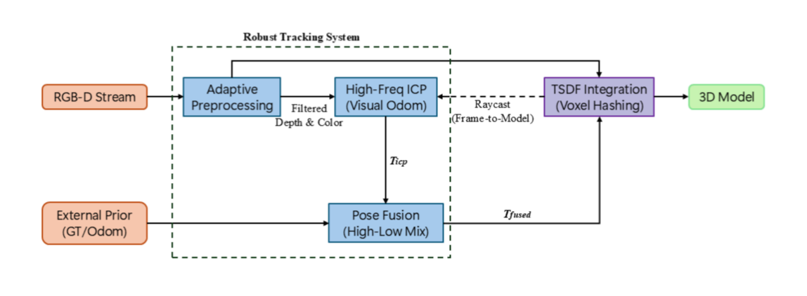
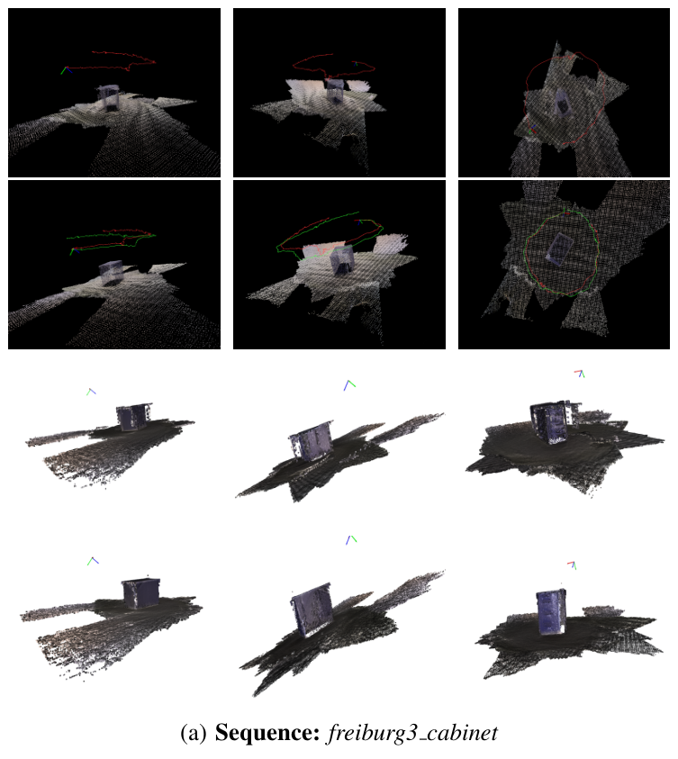
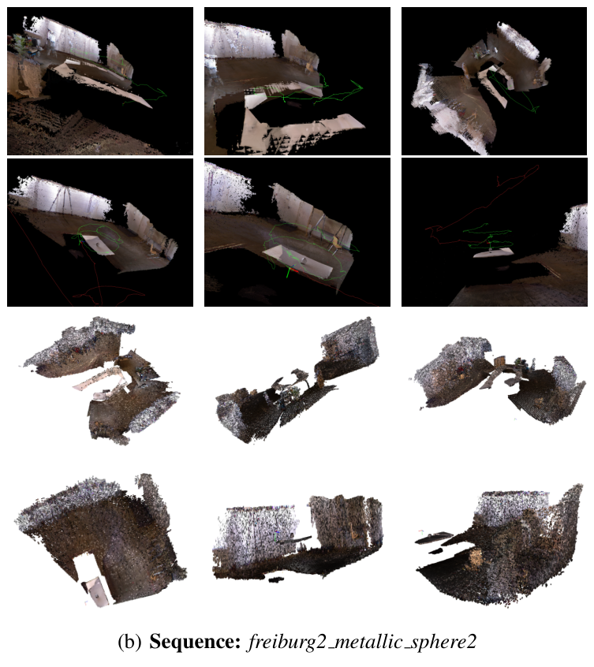
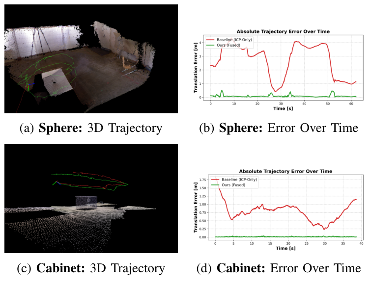
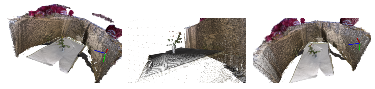

# RGB-D Reconstruction via High-Low Frequency Pose Fusion

**Robust RGB-D Object Reconstruction in Degenerate Scenes via High-Low Frequency Pose Fusion for Industrial Inspection**

Fenglai Lin, Lijun Jiang, Xiaodong Zhang, Ziyi Zhao, Changyun Wen, Mingduo Yan, Nathan Zhao, Yifan Zhao, and Wei jye Ng

[Paper](Essay/Robust_RGB_D_Object_Reconstruction_in_Degenerate_Scenes_via_High_Low_Frequency_Pose_Fusion.pdf) · [Results](#results) · [Quick start](#quick-start) · [Reproduction notes](#reproduction-notes)

RGB-D reconstruction can drift or fragment when the scene contains large textureless planes, reflective surfaces, or thin structures. This project combines local ICP motion estimates with attenuated external pose corrections on **SE(3)**, then integrates the processed depth maps into a **TSDF** volume.

The repository contains the research scripts and experimental material accompanying the paper, including TUM RGB-D reconstruction experiments and auxiliary stereo/depth tools.

## Overview



*System schematic from the project. The current main script performs frame-to-frame registration; the dashed frame-to-model raycasting path in the schematic is not implemented in that tracking loop.*

The reconstruction pipeline has three main components:

1. **Adaptive depth preprocessing.** Quantile-based depth bounds are smoothed over time, while bilateral filtering suppresses local noise. Configurable ROI and background filtering isolate the reconstruction target.
2. **High-low frequency pose fusion.** Local registration provides motion updates; external poses supply attenuated, bounded corrections to accumulated drift.
3. **TSDF reconstruction.** Depth and color observations are integrated using the selected pose stream, with live visualization and point-cloud export.

The current main implementation uses ORB-PnP initialization, multiscale Colored ICP, and a robust point-to-plane ICP fallback. The pose correction is:

$$
\xi = \operatorname{Log}(T_{\mathrm{prior}}T_{\mathrm{est}}^{-1}),\qquad
T_{\mathrm{fused}} = \operatorname{Exp}\!\left(\operatorname{clamp}(\alpha\xi)\right)T_{\mathrm{est}}.
$$

Here, “high-low frequency” describes the roles of local motion and prior corrections, rather than an explicit Fourier decomposition. The method uses an external pose stream; its performance therefore depends on the quality of that prior.

## Results

### Reconstruction in degenerate scenes

The following panels reproduce the reconstruction evolution figures in the paper. They include trajectory overlays and geometry views across the ICP-only and prior-assisted experiments; see the paper for the experimental discussion.

| Textureless cabinet | Reflective metallic-sphere scene |
| :---: | :---: |
|  |  |
| `freiburg3_cabinet` | `freiburg2_metallic_sphere2` |

### Trajectory accuracy



*Trajectory visualizations and error curves from the paper. Red: ICP-only baseline. Green: fused trajectory.*

| TUM RGB-D sequence | ICP-only ATE RMSE ↓ | Fused ATE RMSE ↓ | Reported reduction |
| --- | ---: | ---: | ---: |
| `freiburg2_metallic_sphere2` | 2.9777 m | **0.1267 m** | 95.74% |
| `freiburg3_cabinet` | 0.8300 m | **0.0126 m** | 98.48% |

These are the paper's reported results, not measurements rerun for this README. When a reference trajectory is also supplied as the fusion prior, ATE measures performance conditioned on that prior; it is not an independent evaluation of prior-free odometry. Current script defaults also differ from the paper configuration; see [Reproduction notes](#reproduction-notes).

### Thin-structure challenge



*Early-stage reconstruction of the flowerbouquet sequence, reproduced from the paper.*

Thin structures remain challenging when depth is missing or inconsistent. Pose stabilization alone does not recover unobserved geometry, and the paper reports deterioration during prolonged integration in this sequence.

## Repository layout

```text
.
├── High-Low Frequency Pose Fusion/
│   ├── GT+ICP_external_prior_fusion_tsdf_live.py  # Main TUM reconstruction script
│   ├── gt_icp_tsdf_tum_sphere_fix.py             # Scene-specific experiment variant
│   ├── gt_icp_tsdf_tum_flowerbouquet_fix_v20.py   # Thin-structure experiment variant
│   ├── redwood_batch_tsdf.py
│   ├── TSDF_live_demo.py
│   └── Results for Essay/                      # Local figures and experiment snapshots
├── Essay/                                     # Paper PDFs
├── docs/readme/                                # README figures from the paper
├── RAFT-Stereo/                                # Auxiliary stereo-depth code
├── extract_svo.py                              # ZED recording extraction utility
├── DepthSwinFPN_main.py                         # Separate supervised depth experiment
├── main.py                                     # KITTI SGBM-to-point-cloud example
├── view_outputs.py
├── unzipbag.py
└── requirements.txt
```

**The paper's reconstruction entry point is inside `High-Low Frequency Pose Fusion/`, not the root `main.py`.** Dataset, checkpoint, backup, and some output directories are excluded by `.gitignore` and may only exist in the original local workspace.

## Quick start

### 1. Prepare the environment

Use a dedicated Python environment. The core packages recorded in this repository are:

```powershell
python -m pip install numpy==2.2.6 opencv-python==4.10.0.84 open3d==0.19.0 matplotlib==3.10.6
```

`requirements.txt` is a broader Windows environment snapshot, including ZED-related packages. It is not a portable minimal environment specification. Installation and runtime have not been revalidated as part of this documentation update.

- **GPU execution:** CUDA-enabled OpenCV/Open3D builds are needed for their GPU paths. Installing standard wheels does not guarantee CUDA support; the scripts include runtime checks and fallbacks.
- **ZED extraction:** requires a compatible ZED SDK, Python API, and CUDA installation. These are not needed for the TUM reconstruction path.
- **Learned depth tools:** RAFT-Stereo and the separate depth-training script require their own dependencies and weights, including PyTorch.
- **Display:** the main script uses OpenCV windows and an interactive ROI. Run it in a desktop session; disabling Open3D live visualization alone does not remove all GUI calls.

### 2. Prepare a TUM-style sequence

```text
sequence/
├── rgb/                  # Timestamp-named RGB frames
├── depth/                # Aligned depth frames
├── associations.txt      # Recommended explicit RGB/depth associations
└── groundtruth.txt       # External pose stream, when available
```

Association format:

```text
t_rgb rgb/t_rgb.png t_depth depth/t_depth.png
```

Pose format:

```text
timestamp tx ty tz qx qy qz qw
```

Without an association file, the main script uses nearest timestamp matching within 0.050 seconds. Pose lookup also reads image filename timestamps, so integer frame IDs are not a substitute for acquisition times.

The main loader converts `uint16` TUM depth to meters with **`depth / 5000`**. Millimeter depth images require **`depth / 1000`** instead. Intrinsics are selected from Freiburg identifiers in the sequence path; configure actual intrinsics when using another camera.

### 3. Configure the reconstruction

Edit the configuration block in `High-Low Frequency Pose Fusion/GT+ICP_external_prior_fusion_tsdf_live.py`:

```python
SEQ_DIR = Path(r"D:\datasets\rgbd_dataset_freiburg2_metallic_sphere2")
OUT_DIR = Path(r"D:\outputs\sphere_fused")
TSDF_POSE_SOURCE = "fused"
```

Check the ROI settings, depth bounds, voxel size, prior timestamp association, and fusion limits. Scripts contain machine-specific paths, and a variant's filename does not determine its configured input sequence.

| Pose source | TSDF behavior |
| --- | --- |
| `"gt"` | Integrate with the aligned external pose directly; skip integration when that pose is unavailable. |
| `"icp"` or `"odo"` | Integrate with the accumulated local odometry trajectory. |
| `"fused"` | Integrate with the corrected trajectory. The current implementation routes other strings through this fallback branch. |

**The current main script defaults to `"gt"`. Set `"fused"` explicitly to evaluate fused-pose reconstruction.** Without a usable prior, the local tracking path has no external drift correction; do not select `"gt"` for integration.

### 4. Run

From the repository root:

```powershell
python ".\High-Low Frequency Pose Fusion\GT+ICP_external_prior_fusion_tsdf_live.py"
```

Configuration is currently script-based rather than a unified CLI. Interactive ROI selection is enabled by default. To change it, review `USE_INTERACTIVE_ROI_ONCE` together with the tracking and integration ROI options.

### 5. Inspect outputs

The main entry point writes the following under `OUT_DIR`:

| Output | Content |
| --- | --- |
| `pcd_final_*.ply` | Final extracted point cloud |
| `snapshots/` | Intermediate exports, when enabled |
| `ate_error_plot_*.png` | Error curves when a reference trajectory is available |
| Console statistics | Tracking acceptance, integration, and trajectory evaluation |
| `live_crash.log` | Exception details, if a run fails |

The main script exports a **point cloud**, not a triangle mesh, even though reconstruction uses a TSDF internally.

## Reproduction notes

The working scripts contain experiment-specific settings. The following differences should be resolved before treating a default run as a paper reproduction:

| Setting | Paper | Current main script |
| --- | --- | --- |
| Fusion gain | 0.10 | 0.25 |
| Rotation correction limit | 1° per update | 2° per update |
| Translation correction limit | 0.01 m per update | 0.03 m per update |
| Integration poses | Fused poses | Direct prior by default (`"gt"`) |
| ATE alignment | Described as Sim(3) | Rotation and translation alignment, without scale estimation |

Record the script version, prior source, preprocessing, ROI, accepted frames, pose-source switch, and evaluation alignment for each experiment. Keep data and depth preprocessing consistent when comparing pose methods. Runtime figures in the paper refer to its reported hardware and configuration.

## ZED and other cameras

`extract_svo.py` is an auxiliary recording utility, not a drop-in adapter for the TUM loader. It exports `rgb_left/`, `rgb_right/`, `depth_16bit/`, and SDK poses into a file named `groundtruth.txt`.

- ZED depth is stored in millimeters, unlike the main loader's TUM depth scale.
- Images use frame-index filenames, while poses are written only when tracking is valid. Explicit frame/timestamp association is required.
- The extractor selects `RIGHT_HANDED_Z_UP`; verify coordinate transforms before integrating depth in the optical camera frame.
- A ZED SDK pose is an **estimate**, even when saved as `groundtruth.txt`. Attenuated fusion cannot guarantee recovery from a systematically wrong prior or distorted depth.

## Acknowledgments and licensing

The experiments use TUM RGB-D data and build on Open3D and OpenCV. Auxiliary stereo experiments include RAFT-Stereo. Respect each dataset's and third-party component's license. This README does not add a license for the repository.

All figures above come from the paper or its existing project artifacts; no reconstruction results were generated or retouched for this README.
